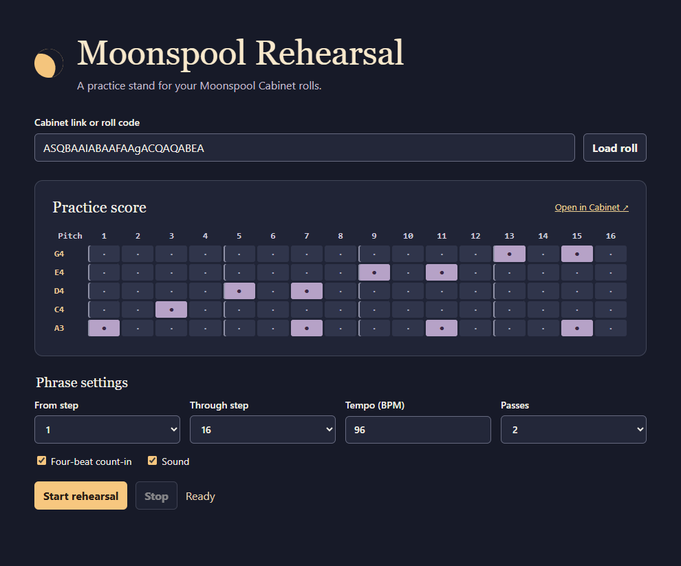

# Moonspool Rehearsal

A Kiro Crew music stand for a tricky passage. Paste a melody from [Moonspool Cabinet](https://marcodipolo.github.io/moonspool-cabinet/), choose a few steps, then rehearse them slowly. A four-beat count-in gives your hands time to get into position. The score follows the current chord or rest and stops after the number of passes you chose.

[Open the browser version](https://marcodipolo.github.io/moonspool-rehearsal/). It uses the same score, controls, timing and synthesizer as the Crew app.



## Install in Kiro Crew

From a terminal with [Kiro Crew](https://github.com/kirodotdev/KiroCrew/releases/tag/v0.13.1) installed, run:

```sh
kirocrew app install https://github.com/MarcoDiPolo/moonspool-rehearsal.git
```

In the Crew dashboard App Store, select the installed **Moonspool Rehearsal**, choose **Enable**, then confirm trust for this app when prompted. Your normal third-party app policy can stay in effect. Once the app has this specific approval, `kirocrew app enable moonspool-rehearsal` also works. Open the app under Apps. Its route is `/apps/moonspool-rehearsal`.

A local checkout also works as the argument to `kirocrew app install`. The dashboard supplies React to the entry module in `ui/crew.mjs`. The app ships its own JavaScript and CSS with the repository, so it needs no build, server, API key, microphone or agent permissions.

## Try a phrase

The stand opens on Moonrise at 96 BPM. Set **From step** to **7** and **Through step** to **8**. Set **Tempo** to **60** and **Passes** to **4**. Press **Start rehearsal**. After the count-in, play **A3 and D4 together** on step 7, then rest on step 8. The stand repeats both steps four times and stops. Switch off **Sound** for silent visual practice. **Stop** ends playback and clears the cursor.

To bring your own music, copy a share link from Cabinet into **Cabinet link or roll code** and select **Load roll**. You can also paste the fragment or 24-character code. The stand reads the 16 sixteenth notes, each five-pitch chord and the original tempo directly from the link. The practice tempo and phrase selection only affect rehearsal. **Open in Cabinet** opens the original arrangement for editing.

For local browser use, serve the checkout using `python -m http.server 8000 --bind 127.0.0.1` and open `http://127.0.0.1:8000/`.

## Verification

Run `node --test test/music.test.mjs` to check all 32 possible pitch masks at every supported tempo, roll validation and phrase timing, including cutoffs at fractional tempos. To exercise the browser, install Playwright in a test environment, install its Chromium browser with `npx playwright install chromium`, then run `node test/browser.cjs`. You can point `CHROMIUM_PATH` at an existing Chromium-based browser.

The integration test in `test/crew_gateway.py` uses Kiro Crew’s own release harness and Playwright. Run it with Python 3.12, the verified wheel from the linked release, and Playwright accessible to Node. It starts an isolated local dashboard, installs and enables the project, verifies the served assets and opens the native app route. Its throwaway login stays in memory.

On November 26, 2026, the Windows test used Kiro Crew 0.13.1 and Microsoft Edge. The release accepted the manifest and installed and enabled the app under a grant specific to Moonspool Rehearsal. The five served modules and styles matched the checkout byte-for-byte. In the dashboard, the React component opened the Moonrise roll and completed a two-pass rehearsal of the A3 + D4 chord at step 7. The separate browser check exercised the audible count-in, stop control, silent playback, narrow screen and cleanup on navigation.

## Built with Kiro

Kiro CLI 3.6.0 produced the initial practice-plan and playback-position functions from [this prompt](.kiro/transport-prompt.txt). While testing a five-step phrase at 97 BPM, we found that rounding could leave the cursor on the previous step at an exact boundary. The shipped engine compares the elapsed time against the same absolute times used to schedule the notes. The browser and Crew integration tests exercise the finished instrument.

## License

[MIT](LICENSE). The app uses browser-generated tones.
